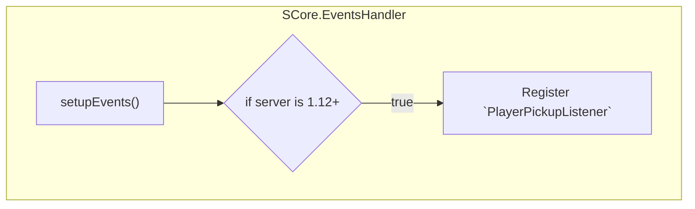

# Processing Dropping and Picking up ExecutableItem ItemStacks

This page documents how ExecutableItems handles an ExecutableItem ItemStack when it is dropped and when it is picked up.

## Dropping ExecutableItem ItemStacks

References:
- `com.ssomar.executableitems.listeners.DropEvent`
- `com.ssomar.executableitems.listeners.DropEventAbove1v12`
- `com.ssomar.executableitems.listeners.restrictions.ResctrictionsEvt#onPlayerDropItemEvent`
- `com.ssomar.score.events.EventsHandler`

## Picking up ExecutableItem ItemStacks

References:
- `com.ssomar.executableitems.listeners.PlayerPickupLimit`
- `com.ssomar.executableitems.listeners.PlayerPickupLimit1v8`
- `com.ssomar.executableitems.listeners.restrictions.Restrictions1v8Events`
- `com.ssomar.score.events.PlayerPickupListener`

For stopping player pickups by cancelling the event if needed. Sample relevant use case: `CANCEL_PICKUP` player/target commands

