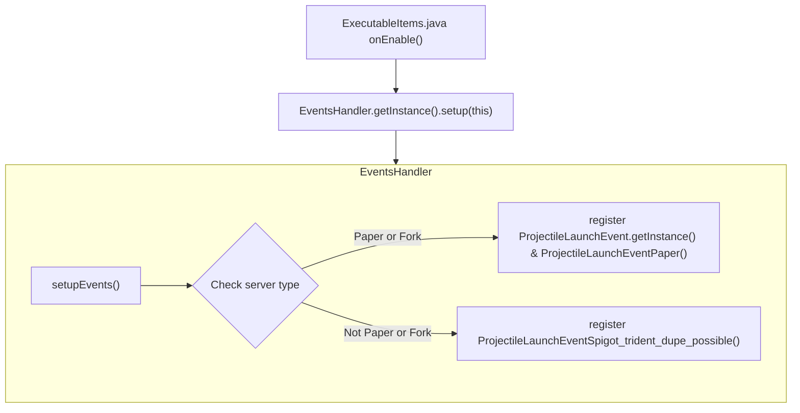
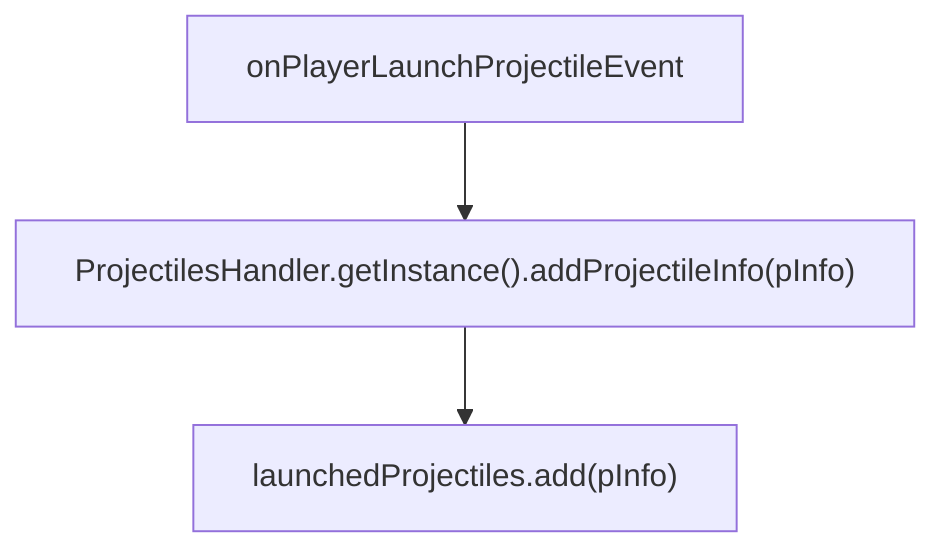
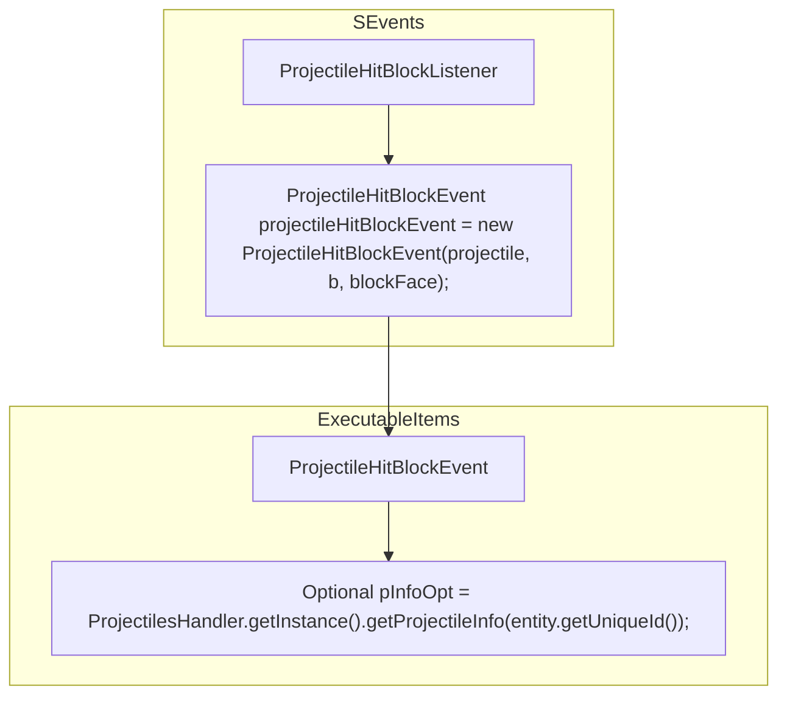

# ⚙ Processing Projectile Information for Activators

This page is all about how projectile information is processed for activator use.
  
Package: `com.ssomar.executableitems.listeners.projectiles`

## Registering Projectile Launch Activators

<div className="mermaid-block">


</div>

## ProjectilesHandler's Role In Managing Projectile Info 

ProjectilesHandler Class: `com.ssomar.executableitems.listeners.projectiles.ProjectilesHandler`

> What it does is it records information about all launched projectiles ranging from arrows to tridents. Doesn't require projectile launch activators to be registered.
> 
> When a projectile is launched, it's saved as a `ProjectileInfo` object. You can check the object attributes to see what information is stored in it to get an idea.
> 
> This information can be used by other activators such as `PROJECTILE_HIT_BLOCK` to perform further checks.

<details>
<summary>ProjectileInfo Class</summary>
Reference: `com.ssomar.executableitems.listeners.projectiles.ProjectileInfo`


```java
@Getter
public class ProjectileInfo {

    private final Player launcher;
    private final UUID uuid;
    private final Optional<ExecutableItemObject> eiOpt;
    private final int slot;
    private final long creationTime;
    @Setter
    private boolean isInLiquid = false;

    public ProjectileInfo(Player launcher, UUID uuid, Optional<ExecutableItemObject> eiOpt, int slot, long creationTime) {
        this.launcher = launcher;
        this.uuid = uuid;
        this.eiOpt = eiOpt;
        this.slot = slot;
        this.creationTime = creationTime;
    }

    public String toString() {
        return "launcher: " + launcher + " uuid: " + uuid + " item: " + eiOpt.isPresent();

    }
}

```

</details>

<hr/>

### ⚙ PROJECTILE_HIT_BLOCK using ProjectileHandler's Information

Class: `com.ssomar.executableitems.listeners.projectiles.ProjectileLaunchEventPaper`

> For example, when a trident is thrown, this event listener is executed and proceeds to save information to the `launchedProjectiles` list.

<div className="mermaid-block">

</div>

> So when `PROJECTILE_HIT_BLOCK` is executed, it can use `ProjectilesHandler.getInstance().getProjectileInfo(entity.getUniqueId())` to get information


Class: `com.ssomar.executableitems.listeners.projectiles.ProjectileHitBlockEvent`

<div className="mermaid-block">

</div>

<hr/>

### ⚙ Logic flow for Projectile Reusability
> This graph shows how projectiles with multiple usages are handled. After reading this graph, you should be able to better understand how projectile items with multiple usages are handled.

<div className="mermaid-block">

```mermaid
flowchart TD
  subgraph _
    subgraph ProjectileLaunchEventPaper
      A["Registered PlayerLaunchProjectileEvent is triggered <hr/> ex: <code>ProjectileLaunchEventPaper</code> "]
      -->
      B["Get entity from the launch event <hr/> Projectile projectile = e.getProjectile();"]
      -->
      C["Get held item in mainhand <hr/> itemSMainHand = p.getInventory().getItemInMainHand();"]
      -->
      D["Compare the thrown projectile's ItemStack with the held ItemStack in hand to figure out the slot number (ex: slot 0-8 or slot 40 which is offhand)"]
      -->
      E["Create a new <code>ExecutableItemObject</code> object by passing the event's projectile's ItemStack."]
      -->
      F{"If the provided ItemStack is a valid ExecutableItem"}

      F--"no"-->G["ExecutableItem is set to null"]

      F--"yes"-->H["ExecutableItem is valid"]
      -->
      I["Insert ExecutableItem-specific metadata to the ExecutableItem's ItemStack"]
      -->
      J[""]
    
    end
  end
```

</div>