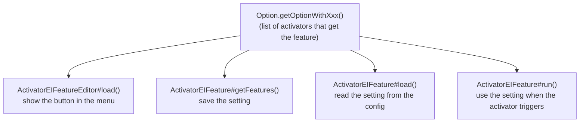

# ✍ Adding Features to Specific Activators in the Menu

This page shows how to add a new setting to the **activator editor** of ExecutableItems so that it only shows up (and is only loaded, saved and checked) when a certain activator option is selected.

A good example of this already in the code is `detailedDamageCauses`: it only appears for hit/damage activators like `PLAYER_HIT_ENTITY` or `PLAYER_RECEIVE_HIT_GLOBAL`, because those are the only activators that have a damage cause.

Reference commits for a complete, small, real example (the `registerCommand` setting that only shows up for `PLAYER_WRITE_COMMAND`):
- SCore: https://github.com/Ssomar-Developement/SCore/commit/a4d49aaf8e50beea75601e48616f9e3f9c2ffafb
- ExecutableItems: `66023565` — *PLAYER_WRITE_COMMAND: opt-in registerCommand*

## How it works

Everything is controlled by one thing: a **static list of options** in `Option.java`. Each place that deals with the activator's features asks *"is the currently selected option in this list?"* before it touches the feature.

<div className="mermaid-block">


</div>

When the user changes the option in the menu (or the type target), `ActivatorEIFeatureEditorManager#reloadEditor` calls `ActivatorEIFeatureEditor#load()` again, so the menu is rebuilt and your feature appears or disappears by itself. You don't need to do anything for that part.

## The files you will touch

| Project | File | What to do |
|---|---|---|
| SCore | `com.ssomar.score.features.FeatureSettingsSCore` | Register the setting (config key, saving behavior) |
| SCore | `com.ssomar.score.features.lang.FeatureSettingsSCore<LANG>` (+ `FeatureSettingsSCoreEN_FLAT.txt`) | Name, description and icon shown in the editor, for every language |
| ExecutableItems | `com.ssomar.executableitems.executableitems.activators.Option` | Create the list of options that get the feature |
| ExecutableItems | `com.ssomar.executableitems.executableitems.activators.ActivatorEIFeature` | Field, `reset()`, `getFeatures()`, `load()`, `clone()`, `reload()`, and the check in `run()` |
| ExecutableItems | `com.ssomar.executableitems.executableitems.activators.ActivatorEIFeatureEditor` | Put the button in the menu |

:::info
If the feature only reuses an existing feature setting (for example, a new activator that should also get `detailedDamageCauses`), you only have to **add the option to the existing list** in `Option.java`. Everything else is already wired. The rest of this page is for a brand new feature.
:::

<hr/>

## Step 1 — Register the feature settings in SCore

Every feature needs a `FeatureSettingsSCore` entry. It gives the feature its config key and how it is saved.

Class: `com.ssomar.score.features.FeatureSettingsSCore`

```java
detailedDamageCauses(getFeatureSettings("detailedDamageCauses")),
registerCommand(getFeatureSettings("registerCommand", SavingVerbosityLevel.SAVE_ONLY_WHEN_DIFFERENT_DEFAULT)),
```

> `SAVE_ONLY_WHEN_DIFFERENT_DEFAULT` keeps the item config clean: the key is only written when the user changed it from its default value. Good for opt-in booleans.

Then add the editor text in **every** language file in `com.ssomar.score.features.lang` (`FeatureSettingsSCoreEN`, `FR`, `DE`, `ES`, ... and `FeatureSettingsSCoreEN_FLAT.txt`). If a language is missing, SCore prints `No feature Translation found for setting` in the console and falls back to English.

```java
// FeatureSettingsSCoreEN(String name, String editorName, String[] editorDescription, Material editorMaterial)
detailedDamageCauses("detailedDamageCauses", "Detailed DamageCauses", new String[]{"&7&oSpecify a list of damageCauses that", "&7&ocan be affected", "&7&oempty = all causes"}, Material.BONE),
registerCommand("registerCommand", "Register Command", new String[]{"&7&oRegister the commands of", "&7&odetailedCommands on the server:", "&7&ono more Unknown command,", "&7&otab completion"}, null),
```

> The last argument is the icon of the button. `null` uses the default icon of the feature type.

:::caution
ExecutableItems compiles against the `SCore.jar` in `src/main/resources`. After changing SCore, build it and replace that jar, otherwise `FeatureSettingsSCore.yourFeature` won't exist for ExecutableItems.
:::

## Step 2 — Create the option list in `Option.java`

Class: `com.ssomar.executableitems.executableitems.activators.Option`

This list decides **which activators get your feature**. Copy the pattern of the existing lists:

```java
public static List<Option> getOptionWithDetailedDamageCauses() {
    List<Option> result = new ArrayList<>();
    result.add(Option.PLAYER_BLOCK_HIT_OF_ENTITY);
    result.add(Option.PLAYER_BLOCK_HIT_OF_PLAYER);
    result.add(Option.PLAYER_DEATH);
    result.add(Option.PLAYER_HIT_ENTITY);
    result.add(Option.PLAYER_HIT_PLAYER);
    result.add(Option.PLAYER_HIT_SHIELD_OF_PLAYER);
    result.add(Option.PLAYER_RECEIVE_HIT_BY_ENTITY);
    result.add(Option.PLAYER_RECEIVE_HIT_BY_PLAYER);
    result.add(Option.PLAYER_RECEIVE_HIT_GLOBAL);

    return result;
}
```

If your feature fits an existing group (for example, all activators with a command, `getOptionWithCommand()`), reuse that list instead of making a new one. `registerCommand` does that: it reuses `getOptionWithCommand()`, which only contains `PLAYER_WRITE_COMMAND`.

Other lists already available: `getOptionWithDrops()`, `getOptionWithDetailedClick()`, `getOptionWithDetailedInput()`, `getOptionWithDetailedEffects()`, `getOptionWithOnlyTypeClick()`, `getOptionWithTargetBlockSt()`, `getOptionWithTargetEntitySt()`, `getOptionWithTargetPlayerSt()`, `getOptionWithTargetItemSt()`, `getOptionResultOfProjectile()`. There is also the opposite kind, `getOptionWithoutDetailedSlots()`, for a feature every activator has *except* some.

## Step 3 — Add the feature to `ActivatorEIFeature`

Class: `com.ssomar.executableitems.executableitems.activators.ActivatorEIFeature`

This class holds the activator's features. There are **six** places to update. Missing one gives silent bugs (see [Common mistakes](#common-mistakes)).

### 3.1 Field

The class uses Lombok `@Getter` / `@Setter`, so the getter and setter are generated for you.

```java
private ListDamageCauseFeature detailedDamageCauses;
/* PLAYER_WRITE_COMMAND: register the commands of detailedCommands on the server (opt-in) */
private BooleanFeature registerCommand;
```

### 3.2 `reset()` — create it with its default value

```java
this.detailedDamageCauses = new ListDamageCauseFeature(this, new ArrayList<>(), FeatureSettingsSCore.detailedDamageCauses);

this.registerCommand = new BooleanFeature(this, false, FeatureSettingsSCore.registerCommand);
```

> Always create it, even for activators that don't use it. The other methods call it, and a `null` would crash them.

### 3.3 `getFeatures()` — gate it with the option list

`save()` loops over `getFeatures()`, so this decides whether the setting is written to the config.

```java
if (Option.getOptionWithDetailedDamageCauses().contains(optionFeature.getValue())) {
    features.add(detailedDamageCauses);
}

if (Option.getOptionWithCommand().contains(optionFeature.getValue())) {
    features.add(detailedCommands);
    features.add(registerCommand);
}
```

### 3.4 `load(...)` — read it from the config

```java
if (Option.getOptionWithDetailedDamageCauses().contains(optionFeature.getValue())) {
    errors.addAll(detailedDamageCauses.load(sPlugin, section, premiumLoading));
}

if (Option.getOptionWithCommand().contains(optionFeature.getValue())) {
    errors.addAll(detailedCommands.load(sPlugin, section, premiumLoading));
    errors.addAll(registerCommand.load(sPlugin, section, premiumLoading));
}
```

### 3.5 `clone(...)` — copy it into the clone

The editor **never edits the real activator**. It edits a clone (`ActivatorEIFeatureEditorManager#buildEditor` → `parent.clone(...)`). If your feature isn't cloned, the editor shows the default value instead of the real one.

```java
clone.setDetailedDamageCauses(detailedDamageCauses.clone(clone));
clone.setRegisterCommand(registerCommand.clone(clone));
```

### 3.6 `reload()` — copy it back to the real activator

When the user saves the editor, `reload()` copies every feature from the edited clone back to the activator that is really in use. If your feature isn't here, the change is written to the file but won't be used until `/ei reload`.

```java
a.setDetailedDamageCauses(detailedDamageCauses);
a.setRegisterCommand(registerCommand);
```

## Step 4 — Show it in the editor

Class: `com.ssomar.executableitems.executableitems.activators.ActivatorEIFeatureEditor`

In `load()`, put the button in a slot, gated with the same option list:

```java
if (Option.getOptionWithDetailedDamageCauses().contains(activator.getOption())) {
    activator.getDetailedDamageCauses().initAndUpdateItemParentEditor(this, 6);
} else if (Option.getOptionWithCommand().contains(activator.getOption())) {
    activator.getDetailedCommands().initAndUpdateItemParentEditor(this, 6);
    activator.getRegisterCommand().initAndUpdateItemParentEditor(this, 12);
}
```

About the slot:
- The menu is `6 * 9` = 54 slots. The bottom row (`45` to `53`) is used by Back, Reset, Language and Save.
- Several features **share a slot** because they can never be shown together, which is why it's an `if / else if`. Slot `6` is `detailedDamageCauses` for hit activators and `detailedCommands` for `PLAYER_WRITE_COMMAND`. Slot `5` is shared by `mustBeAProjectileLaunchWithTheSameEI`, `loopFeatures`, `scheduleFeatures` and `disableDrops`.
- Before taking a slot, check that no other feature uses it **for the same option**, or one will cover the other.

You don't need to do anything for the click: `FeatureEditorManagerAbstract` finds which feature was clicked from the button's name, and `ActivatorEIFeatureEditorManager` rebuilds the menu when the option changes.

## Step 5 — Use the value when the activator runs

The setting does nothing until it's checked when the activator triggers. That's in `ActivatorEIFeature#run(...)`, where every check stops the activator with `return` if it doesn't pass:

```java
/* Verification of detailedDamageCause option for the activator that have it */
if (Option.getOptionWithDetailedDamageCauses().contains(optionFeature.getValue()) && eInfo.getDamageCause().isPresent() && !detailedDamageCauses.verifCause(eInfo.getDamageCause().get()))
    return;
```

Things to keep in mind:
- **Gate it with the option list again.** The feature still exists with its default value on other activators, so without the gate you would check it where it makes no sense.
- **The data comes from `EventInfo`.** `detailedDamageCauses` reads `eInfo.getDamageCause()`, which the listener of the event filled in. If your feature needs data from the event that `EventInfo` doesn't have yet, add it to `EventInfo` (SCore) and set it in the listeners of the activators in your option list. See [Processing Activator Triggers](../execution_flows/processing_activator_triggers.md) for how listeners build the `EventInfo`.
- Use `sendDebugMsg(...)` before the `return`, like the other checks, so the debug mode shows why the activator stopped.

Some features are not checked in `run()` at all. `registerCommand` is read when the items are loaded (`RegisteredCommandActivators`) to register the commands on the server, not when the activator triggers.

<hr/>

## Checklist

- [ ] `FeatureSettingsSCore` entry (SCore)
- [ ] Text in every `FeatureSettingsSCore<LANG>` file + `FeatureSettingsSCoreEN_FLAT.txt` (SCore)
- [ ] SCore built and `SCore.jar` updated in ExecutableItems
- [ ] `Option.getOptionWithXxx()` list (new or existing)
- [ ] `ActivatorEIFeature`: field
- [ ] `ActivatorEIFeature`: `reset()`
- [ ] `ActivatorEIFeature`: `getFeatures()` (gated)
- [ ] `ActivatorEIFeature`: `load()` (gated)
- [ ] `ActivatorEIFeature`: `clone()`
- [ ] `ActivatorEIFeature`: `reload()`
- [ ] `ActivatorEIFeatureEditor#load()` (gated, free slot)
- [ ] Check in `run()` (gated), if the feature affects triggering

## Common mistakes

| Symptom | Missing step |
|---|---|
| The button never shows in the editor | `ActivatorEIFeatureEditor#load()`, or the option is not in the list |
| The button shows for the wrong activators | Wrong option list, or the `if` isn't gated |
| Another button disappeared | Slot already used by a feature shown for the same option |
| The editor always shows the default value | `clone()` |
| The value is saved to the file but ignored until `/ei reload` | `reload()` |
| The value is never written to the file | `getFeatures()` |
| The value is reset after `/ei reload` or a restart | `load()` |
| `NullPointerException` when opening the editor or saving | `reset()` |
| `No feature Translation found for setting` in console | A language file in `com.ssomar.score.features.lang` |
