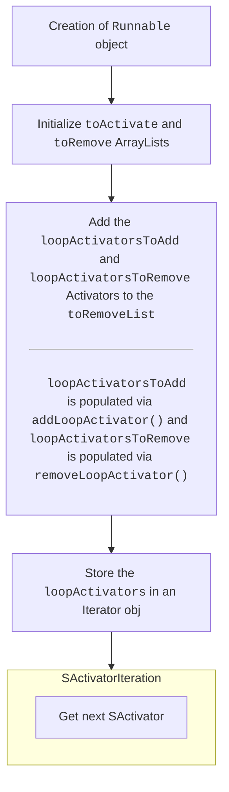

# ⚡ Executing Loop Activators

Class: `com.ssomar.score.events.loop.LoopManager`

## Registering new Loop Activators

Reference: `com.ssomar.executableevents.events.EventsManager`

```java
    @Override
    public void save(ConfigurationSection config) {
        ConfigurationSection attributeConfig = config.createSection(getId());

        /* Add the activator to the LOOP Manager if its a LOOP activator and if it is not present (new activator) */
        if (optionFeature.getValue().isLoopOption()) {
            SsomarDev.testMsg("delay >> " + loopFeatures.getDelay().getValue().get(), true);
            LoopManager.getInstance(ExecutableEvents.plugin.getPlugin()).addLoopActivator(this);
        } else LoopManager.getInstance(ExecutableEvents.plugin.getPlugin()).removeLoopActivator(this);

        OptimizedEventsHandler.getInstance().read(optionFeature.getValue());

        for (FeatureInterface feature : getFeatures()) {
            feature.save(attributeConfig);
        }
    }
```
> A loop activator is registered to the LoopManager

Reference: `com.ssomar.score.events.loop.LoopManager#addLoopActivator`

```java
    public void addLoopActivator(SActivator activator) {
        if (activator == null) return;

        loopActivatorsToAdd.add(activator);
    }
```

## Running Loop Activators (Incomplete)

Reference: `com.ssomar.score.events.loop.LoopManager#runLoop`

