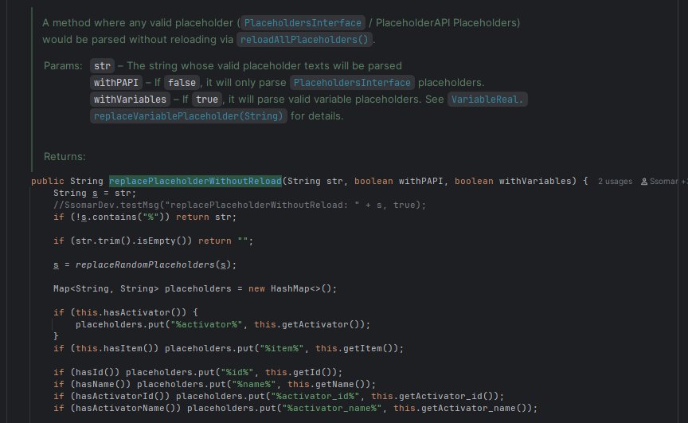

# Parsing Placeholders
> This page talks about how placeholders like PlaceholderAPI placeholders, Player Placeholders, Block Placeholders, SCore Variable placeholders are parsed.

## Replace Placeholders in command executions

:::info
PlaceholderAPI is not required to parse SCore placeholders (variables, damage boost, damage resistance) in command executions
:::

Reference: `com.ssomar.score.utils.placeholders.StringPlaceholder#replacePlaceholderWithoutReload(java.lang.String, boolean, boolean)`

> `replacePlaceholderWithoutReload(String str, boolean withPAPI, boolean withVariables)`
> This method is used to replace valid placeholders in a given string and return the string with the valid placeholders parsed.
> 
>   

### Replace SCore Placeholders in command executions

Reference: `com.ssomar.score.utils.placeholders.StringPlaceholder#replacePlaceholderOfSCore`

> Later down the line in `replacePlaceholderWithoutReload()`, it will execute `replacePlaceholderOfSCore` and search for regex patterns of `%score_*` to find valid SCore placeholders and replace them in the provided string.

<br/>
<br/>
<hr/>
<br/>
<br/>

## Replace Placeholders in ItemStack lore

:::info
PlaceholderAPI is required to parse SCore placeholders (variables, damage boost, damage resistance, glow color, cooldown) in item lores.
:::

:::warning
For player-dependent PlaceholderAPI placeholders, the item **has** to have internal owner data or else it will parse it based on the first player in the online player list.
:::

ExecutableItems will be used as an example on how placeholders are parsed in ItemStacks.
For refresher, when ExecutableItems forms an ItemStack's meta, it refreshes a blank Material ItemStack with `refreshMeta()`
```java title="com.ssomar.executableitems.executableitems.ExecutableItemObject#refreshMeta"
public void refreshMeta(DynamicMeta dMeta, List<ResetSetting> resetSettings) {
        // ITEM LORE
        if (resetSettings.contains(ResetSetting.LORE)) this.refreshLore(dMeta, true);
```


### refreshLore() call

> This method specifically is used to generate/build an ItemStack's lore. Somewhere in this code is responsible for parsing placeholders in it.

```java title="com.ssomar.executableitems.executableitems.ExecutableItemObject#refreshLore(com.ssomar.score.utils.DynamicMeta, boolean)"

        boolean containsDurabilityPlaceholder = false;
        for (int i = 0; i < lore.size(); i++) {
            String s = lore.get(i);
            if (s.contains("%durability%")) containsDurabilityPlaceholder = true;
            s = refreshVariables_Owner_Usage_PlaceholdersInString(s, s);
            lore.set(i, s);
        }

        addUsageParticleInLore(lore);
        meta.setLore(lore);
```

After looking, `refreshVariables_Owner_Usage_PlaceholdersInString` would be responsible for placeholder parsings.

### refreshVariables_Owner_Usage_PlaceholdersInString();

> This section contains the logic where parsing PlaceholderAPI placeholders are done. This information will be relevant when finding where and how SCore Variable Placeholders are parsed in item lores.

```java
            /* After usage to make the math functions of papi work with %usage% */
            if (SCore.hasPlaceholderAPI) {
                SsomarDev.testMsg(" has papi", DEBUG);
                if (potentialOwner.isPresent()) {
                    toReplace = StringConverter.coloredString(me.clip.placeholderapi.PlaceholderAPI.setPlaceholders(potentialOwner.get(), toReplace));
                    SsomarDev.testMsg(" toReplace papi : " + StringConverter.deconvertColor(toReplace), DEBUG);
                }
                else if (Bukkit.getOnlinePlayers().size() > 0)
                    toReplace = StringConverter.coloredString(me.clip.placeholderapi.PlaceholderAPI.setPlaceholders(Bukkit.getOnlinePlayers().iterator().next(), toReplace));
            }
```

### PlaceholderAPI request for SCore PAPI Support

> SCore directly supports PlaceholderAPI, allowing other plugins to access information SCore has in the form of placeholders.

```java title="com.ssomar.score.usedapi.PlaceholderAPISCoreExpansion#onRequest"
@Override
    public String onRequest(OfflinePlayer player, String params) {
        System.out.println("PAPI params: "+params);

        Optional<String> varPlaceHolder = VariablesManager.getInstance().onRequestPlaceholder(player, params);
        if (varPlaceHolder.isPresent()) return varPlaceHolder.get();

        Optional<String> dmgBoosterPlaceHolder = DamageBoost.getInstance().onRequestPlaceholder(player, params);
        if (dmgBoosterPlaceHolder.isPresent()) return dmgBoosterPlaceHolder.get();

        Optional<String> dmgResistancePlaceHolder = DamageResistance.getInstance().onRequestPlaceholder(player, params);
        if (dmgResistancePlaceHolder.isPresent()) return dmgResistancePlaceHolder.get();

        Optional<String> glowColorPlaceHolder = GlowDropManager.getInstance().onRequestPlaceholder(player, params);
        if (glowColorPlaceHolder.isPresent()) return glowColorPlaceHolder.get();

        Optional<String> cooldownPlaceHolder = CooldownsManager.getInstance().onRequestPlaceholder(player, params);
        if (cooldownPlaceHolder.isPresent()) return cooldownPlaceHolder.get();

        return null;
    }
```

This method override is where SCore placeholders are evaluated. So if you want to find for example, the logic that handles returning the value of SCore variables, check `VariablesManager.getInstance().onRequestPlaceholder(player, params)`.

